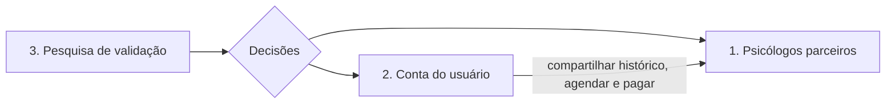

# Expansão para o usuário final — índice

Brainstorm de 17/11/2026 sobre levar o Zelo além do painel agregado para gestores, com mais
funcionalidades para quem usa o app na ponta.

## A ideia em uma frase

O Zelo continua sendo a ferramenta anônima e agregada que as instituições contratam, e passa a
ser também um lugar seguro onde qualquer pessoa acompanha a própria saúde mental e chega a um
psicólogo, anônima ou não, por escolha dela.

## O que não muda

- O modo anônimo sem cadastro continua existindo.
- A instituição nunca vê dado individual: nem respostas, nem quem consultou psicólogo.
- O caminho de crise (CVV 188) funciona sem rede e sem depender de nenhuma parte nova.
- O foco atual em trabalhadores e instituições segue. O público geral é ampliação, não troca.

## As três frentes

| # | Frente | Doc | Estado |
|---|---|---|---|
| 1 | Psicólogos parceiros, consultas e modelos de pagamento | [01-psicologos-parceiros.md](./01-psicologos-parceiros.md) | Rascunho com pesquisa regulatória |
| 2 | Conta opcional e dados próprios do usuário | [02-conta-do-usuario.md](./02-conta-do-usuario.md) | Rascunho com fases e testes |
| 3 | Pesquisa de validação (Google Forms) | [03-pesquisa-de-validacao.md](./03-pesquisa-de-validacao.md) | Pronta para revisão e piloto |

## Como as frentes dependem uma da outra

A pesquisa vem primeiro porque é barata e informa as outras duas. A conta vem antes de
agendamento e pagamento no app, mas a Fase 1 dos psicólogos (agendamento + atendimento fora do
app, pago pela instituição) pode andar sem conta.

## Decisões que travam o resto

| # | Decisão | Onde está detalhada |
|---|---|---|
| 1 | Como ler a regra "`riskSignal` nunca cruza a rede" quando há conta e sincronização | [Frente 2](./02-conta-do-usuario.md) |
| 2 | Modelo de contratação e remuneração dos psicólogos (risco no Código de Ética do CFP, Art. 2º o/p) | [Frente 1](./01-psicologos-parceiros.md) |
| 3 | O que é o pacote grátis e quem banca | [Frente 1](./01-psicologos-parceiros.md) |
| 4 | Plantão como acolhimento eletivo, nunca crise (Res. CFP 11/2018, Art. 6º) | [Frente 1](./01-psicologos-parceiros.md) |
| 5 | Mesma marca/app para público geral ou linha separada | Frentes 1 e 2 |

## Próximos passos sugeridos

1. Revisar e publicar a pesquisa (checklist no fim da [Frente 3](./03-pesquisa-de-validacao.md)).
2. Conversar com os dois psicólogos consultores com as perguntas novas da Frente 1.
3. Buscar parecer jurídico sobre remuneração dos psicólogos, LGPD e Anvisa.
4. Com os resultados, escrever ADRs para as decisões 1 e 2.
